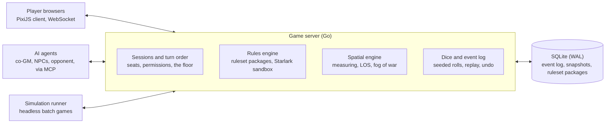

# Chartroom — Design Doc

Nov 1, 2026 · Nick

> Source of truth for Chartroom's design. Changes to decisions recorded here go through an ADR (see `docs/adr/`).

## Vision and goals

We are building a self-hosted, open-source virtual tabletop where every game, 5e included, is a ruleset package and AI is a first-class participant at the table.

Goals:

- **One engine for RPGs and wargames.** 5e, homebrew RPGs, and miniature wargames across ancients, Napoleonic, WW2, modern, and grimdark sci-fi.
- **Homebrew as a core workflow.** Describe a rule in plain English, let the AI draft it, and prove it with tests and simulated games before it reaches the table.
- **AI as a scoped participant.** Co-GM, NPCs, opponent commander, and rules adjudicator, acting through the same interface and permissions as a player seat.
- **Small and self-hosted.** One server, no subscription, no external services required.

Non-goals for v1: 3D rendering, a content marketplace, native mobile apps, built-in voice or video, and shipping any proprietary ruleset.

## Core architecture

One Go server owns all game state in SQLite; browsers, AI agents, and the balance simulator are all clients of the same engine. This mirrors the Conch stack, so tooling and habits carry over.

The rules engine is the heart: everything else either feeds it actions or stores and shows what it decides. Players use a TypeScript browser client rendering the table with PixiJS, AI agents use the MCP endpoint, and the simulator calls the engine directly with no UI.

## Spatial model

The table is a continuous 2D plane measured in inches; squares and hexes are optional snapping layers that a ruleset turns on. This one decision lets 5e on a grid, Napoleonics with measured movement, and hex-and-counter WW2 share an engine.

- **Coordinates.** Every entity has a float position and a rotation. Rotation gives facing for free.
- **Grid layers.** Square or hex overlays snap positions and change how distance is counted. The ruleset supplies the distance rule (for example, 5e's diagonal convention or a hex count).
- **Bases and footprints.** Models have base shapes and sizes. A unit's footprint is its formation outline or the union of its model bases.
- **Facing and arcs.** Rulesets define front, flank, and rear arcs and named formations such as line, column, square, or wedge.
- **Terrain.** Polygons tagged with properties: cover, difficult ground, blocks line of sight, height.
- **Line of sight and measurement.** Computed on the server from footprints and terrain. The ruleset picks the method (centre to centre, base to base, or any point of the footprint). Clients only draw rulers and templates.
- **Fog of war.** Visibility is computed per side on the server, and each client receives only what its side can see.

## Entity model

Every piece on the table is a generic entity whose stats and components are declared by the ruleset, so a wizard, a battalion, and a tank platoon are the same kind of object to the engine.

| Engine concept | 5e | Napoleonic | WW2 skirmish |
| --- | --- | --- | --- |
| Entity | Character or monster | Battalion | Squad or vehicle |
| Models inside | One | Stands of figures | Soldiers, or one vehicle |
| Typical stats | Ability scores, hit points, armour class | Morale, formation, casualties | Troop quality, pins, armour |
| Footprint | Grid squares | Formation rectangle | Individual bases |

- **Components** are typed fields declared in the ruleset schema. The engine validates them, but does not know what they mean.
- **State changes only through actions.** Nothing edits an entity directly; a ruleset action produces events, and the engine applies them.
- **Units contain models**, which lets rulesets handle casualty removal, coherency, and splitting or merging units.

## Rules engine

A ruleset is a versioned package of data plus Starlark scripts; the engine owns state, dice, and turn order, and scripts only compute outcomes.

A ruleset package contains:

- **Manifest:** name, version, license, and what it extends (for example, a homebrew 5e package extends the SRD package).
- **Schemas:** the components and stats its entities carry.
- **Data:** units, weapons, spells, and tables as YAML or JSON.
- **Scripts:** actions, resolution, and turn structure in Starlark. Starlark embeds natively in Go, is deterministic, and cannot reach the filesystem or network.
- **Tests:** small scenarios with expected outcomes, run on every change.

Turn structure is defined by the ruleset, not the engine. The engine provides one primitive, the floor: who may act now and how it passes. That covers initiative (5e), I-go-you-go phases, alternating activations, and simultaneous orders. It is the same idea as the floor token planned for Conch assemblies.

Dice and state:

- **Server-side dice.** Each session has a seeded random source. Scripts request rolls through the engine and cannot make their own randomness.
- **Every roll is logged** with its inputs, modifiers, and result, visible to all players.
- **Event sourcing.** Game state is a fold over the event log, which records accepted outcomes, dice results included, rather than the requests that caused them ([ADR-002](adr/0002-event-log-schema.md)). This gives undo, replay, spectating, and headless simulation from the same code.

## AI and governance tiers

The AI sits at the table like a player seat with scoped permissions: it can act and rule on ambiguity, but it cannot edit state directly or touch the dice.

| Tier | Who | What it does | Example |
| --- | --- | --- | --- |
| Tier-C | Engine and ruleset scripts | Enforces scripted rules, rolls dice, measures | Is the target within musket range? |
| Tier-A | AI | Adjudicates ambiguity, runs NPCs or an opposing side, narrates; every ruling logged with its reason | Does half a unit behind a hedge count as in cover? |
| Tier-H | GM or players | Overrides any ruling; approves rule changes | The GM reverses the cover ruling |

- **MCP endpoint.** AI agents connect through MCP tools such as reading visible state, listing legal actions, taking an action, and proposing a ruling.
- **Roles.** Co-GM, NPC controller, opposing commander, rules lawyer, and homebrew author. Each role is a capability set on a seat.
- **Precedents.** Tier-A rulings are stored per session, so the same question gets the same answer next time unless a human overrides it.
- **Fog applies to AI too.** An AI commander sees only what its side can see.

## Homebrew pipeline and balance simulation

A homebrew rule goes from a plain-English description to a tested, simulated ruleset patch before anyone plays it; this is backtesting for game design, and the feature existing VTTs lack.

1. **Describe** the rule in plain English ("cavalry that charges a unit in line from the flank gets an extra attack die").
2. **Draft.** The AI writes the patch: data changes, Starlark, and test cases.
3. **Test.** The engine runs the package tests. Failures go back to the AI with the error.
4. **Simulate.** Headless batch games compare the patched ruleset against the baseline: win rate by side or faction, game length, and how swingy results are.
5. **Review (Tier-H).** You see the diff and the simulation report, then approve, revise, or drop it.
6. **Playtest.** Rulings and overrides during real games feed back as candidate fixes.

Simulation needs fast players. Scripted heuristic policies give volume; LLM agents play a small sample to catch strategies a heuristic would never try.

## Content and licensing

The repo ships only openly licensed content: the 5e SRD and our own original wargame core, with LANDWAR as the design reference and proprietary rulesets limited to private imports.

| Content | Source | License | In the repo? |
| --- | --- | --- | --- |
| 5e rules | [SRD 5.1 (2014 rules) and SRD 5.2 (2024 rules)](https://www.dndbeyond.com/posts/1949-you-can-now-publish-your-own-creations-using-the) | CC-BY-4.0 | Yes, with attribution |
| Wargame core and period modules | Written by us | CC-BY-4.0 | Yes |
| [LANDWAR](https://subject9x.itch.io/landwar) | Subject9x | CC-BY-SA 4.0 | Reference; anything derived stays CC-BY-SA |
| Little Wars (H. G. Wells, 1913) | Public domain | None needed | Yes, as the first test ruleset |
| [One Page Rules](https://www.onepagerules.com/games/grimdark-future), [WTJ](https://www.wtj.com/games/), Warhammer 40k, Bolt Action | Their publishers | Proprietary | No; private import by the user only |

Period modules planned on the core: ancients, Napoleonic, WW2, modern, and an original grimdark sci-fi setting.

In the US, game mechanics generally are not copyrightable, while rules text, names, lore, and unit data are. Get a legal check before anything is sold.

## Milestones

Build in six milestones, each closed by something you can actually play, so the engine is proven by games rather than by abstractions. Each gate is the milestone's definition of done.

| Milestone | Scope | Gate |
| --- | --- | --- |
| M0: Shared table | Map, tokens, rulers, and a dice log; two browsers stay in sync over WebSocket. Token moves and rolls are already events in the log. | Two players move tokens and roll dice on one table |
| M1: Rules engine | Entity model, ruleset packages, Starlark sandbox, event log; Little Wars as the first ruleset | Little Wars plays end to end and replays from the log |
| M2: 5e combat | SRD combat on a grid: initiative, actions, conditions, a starter set of classes and monsters | One full 5e encounter runs on the table |
| M3: Wargame core | Our measured-movement core: units, formations, facing, morale; the first period module | A full battle plays to a result |
| M4: AI at the table | MCP endpoint, AI opponent and NPCs, Tier-A rulings logged with their reasons | An AI commands one side of a battle |
| M5: Homebrew and simulation | Plain-English rule to tested patch; headless batch games and a balance report | A homebrew rule is drafted, tested, and simulated against its baseline |

Little Wars comes before 5e on purpose: it is simple enough to prove the engine, the event log, and measured movement before the much larger SRD goes in.

## Open questions

- [x] Project name: Chartroom, repo at github.com/njdaniel/chartroom.
- [x] Engine code license: AGPL-3.0, matching Conch; rules content CC-BY-4.0.
- [x] Hosting for v1: a private group over Tailscale; no internet exposure or accounts yet.
- [x] Client renderer: PixiJS for the 2D table.
- [ ] First wargame module: measured miniatures (Napoleonic or ancients) or hex-and-counter WW2? Needed by M3.
- [ ] Which SRD first: 5.1 (2014 rules) or 5.2 (2024 rules)? Needed by M2.
- [ ] Relationship to Conch: share the floor and approval primitives as a library, or run the table as a Conch channel mode?
- [x] How map and token images are uploaded and stored: uploaded over HTTP and stored by content hash in the data directory ([ADR-003](adr/0003-client-server-protocol.md)).
