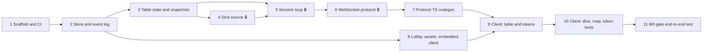

# M0 issue list (proposed)

**Milestone:** M0: Shared table
**Gate:** Two players move tokens and roll dice on one table.

These become GitHub issues with the `ready` label and the M0 milestone once Nick approves this list. Each one is a single branch and PR. 🔒 marks an issue that touches a protected path in ADR-000, so its PR needs Nick's review before merge.

---

## 1. Scaffold the repo and CI

Set up the layout from ADR-001: `go.mod` (with `ignore ./web`), `cmd/chartroomd` that starts and serves a health check, a `web/` Vite + TypeScript skeleton, `Makefile`, `deps-allowlist.txt`, `rulesets/README.md` (license note only), and GitHub Actions.

**Acceptance criteria**
- CI runs `gofmt` check, `go vet`, `go test ./...`, and in `web/`: typecheck, lint, `vitest`, build. A red check blocks merge.
- CI fails if a direct dependency in `go.mod` or `web/package.json` is missing from `deps-allowlist.txt`.
- `make dev` runs the server and the Vite dev server together.
- The "Commands" section of `CLAUDE.md` is filled in.

**Depends on:** ADR-001 accepted.

## 2. SQLite store and append-only event log

`internal/store` opens SQLite in WAL mode and runs migrations. `internal/eventlog` implements the ADR-002 envelope, the `events` table, append, read-from-seq, and a registry of event types with upcaster support.

**Acceptance criteria**
- `UPDATE` and `DELETE` on `events` fail (trigger), with a test.
- Appending a batch of events is one transaction; a failure mid-batch leaves no events behind (test).
- `seq` is gapless per session, and a concurrent-append test can't produce duplicates or gaps.
- Reading an unknown `type` or `data_v` returns an error.
- An upcaster test: a v1 payload is read back as v2.

**Depends on:** 1, ADR-002 accepted.

## 3. Table state, fold, and snapshots

`internal/table` holds M0 state (session, seats, map, tokens, dice generator state) and a pure `Apply(state, event) state`. Snapshot write and load as in ADR-002.

**Acceptance criteria**
- Apply is pure: it never reads the clock, randomness, or I/O.
- A generated-sequence test shows fold-from-zero equals snapshot-plus-tail.
- A snapshot with a different `state_v` is ignored and the session folds from seq 1.
- Deleting all snapshots and reloading gives identical state.

**Depends on:** 2.

## 4. Seeded dice source 🔒

`internal/dice`: per-session ChaCha8 seeded from `crypto/rand` at session creation, a dice expression parser (ADR-003 grammar), and generator state that survives a restart.

**Acceptance criteria**
- The same seed and expressions give the same results, every run (test).
- After a restart (fold from log, or load from a snapshot) the next roll matches what an uninterrupted server would have produced (test).
- Bad expressions are rejected: out-of-range N or M, empty, garbage.
- Game randomness comes only from this package. A CI check fails on any `math/rand` import outside `internal/dice`, and on any `crypto/rand` import outside a short allowlist (event ids, the dice seed, seat tokens).

**Depends on:** 3.

## 5. Session loop and intent handling 🔒

`internal/session`: one goroutine per open session. Intents go through `authorize` → validate → dice → append → apply → fan out, per ADR-003.

**Acceptance criteria**
- All five M0 intent kinds produce the right events. Invalid intents (unknown token, bad coordinates, bad dice expression) are rejected with a code, and nothing is logged.
- `authorize` exists and is called for every intent (test with a deny-all stub).
- Intents from many connections at once are applied in one order, and every client sees the same order (race test with `-race`).
- Sessions load from the log on first use and unload when idle.

**Depends on:** 3, 4.

## 6. WebSocket protocol server 🔒

`/ws` with `hello`/`welcome`, seat creation and seat tokens, `intent`/`ack`/`rejected`/`event`, presence, pings, and the slow-client cutoff. `internal/visibility` with `FilterEvent` and `FilterState`.

**Acceptance criteria**
- A new client gets a seat and a token; reconnecting with the token gives back the same seat.
- The first seat is `gm`, the rest are `player`.
- `dice_seed` never appears in any message to any seat (test over `welcome` and the event stream).
- Every outgoing event and state passes through `visibility` (enforced by a test that swaps in a filter that hides everything).
- A client that stops reading is disconnected without stalling the others (test).
- A protocol version mismatch closes the connection with `protocol_mismatch`.

**Depends on:** 5.

## 7. Generate the protocol's TypeScript types

`cmd/schema-ts` writes `web/src/protocol.gen.ts` from `internal/protocol`.

**Acceptance criteria**
- `make gen` regenerates the file; CI fails if it is stale.
- The client compiles only against generated types for every message.

**Depends on:** 6.

## 8. Lobby, asset upload, and embedded client

HTTP side of ADR-003: session list and create, asset upload and serving, and `go:embed` of the built client.

**Acceptance criteria**
- `POST /api/sessions` appends `session.created` and returns a shareable link.
- Asset upload accepts only PNG, JPEG, and WebP (checked from the bytes), at most 20 MB. Uploading the same file twice gives the same hash and one file on disk.
- `GET /assets/<sha256>` serves with immutable cache headers; unknown hashes return 404.
- `go build ./cmd/chartroomd` gives one binary that serves the client with no `web/` folder present.

**Depends on:** 2 (and 1).

## 9. Client: table rendering and token movement

PixiJS table: connect and handle `welcome`, draw the map at its size in inches, draw tokens, pan and zoom, drag a token (ghost while dragging, `token.move` on drop), apply incoming events, reconnect on drop, and a local ruler in inches.

**Acceptance criteria**
- Tokens move only when their event arrives, never optimistically.
- Reloading the page keeps your seat and shows the current table.
- The ruler shows straight-line distance in inches and sends nothing to the server.
- Vitest covers the client's state reducer for every M0 event type.

**Depends on:** 7, 8.

## 10. Client: dice, map loading, and token tools

Dice roll box and a shared dice log (who rolled, expression, each die, total), map upload and load, place and remove token, and a presence list.

**Acceptance criteria**
- Every roll shows its expression, each die's result, the modifier, and the total, in the same order for all players.
- A rejected intent shows its message to the person who sent it.
- Any seat can upload a map image and load it, and everyone sees it. M0 has no role limits (see the PR's questions).

**Depends on:** 9.

## 11. M0 gate: end-to-end test

A Playwright test with two browser contexts against a real `chartroomd`. This is the definition of done for M0.

**Acceptance criteria**
- Both players join one session from the lobby link.
- Player A places and moves a token; player B sees it move.
- Player B rolls `2d6+3`; both see the same dice and total in the log.
- The server is restarted; both players reconnect and see the same table and dice log, rebuilt from the event log.
- Runs in CI.

**Depends on:** 10.
