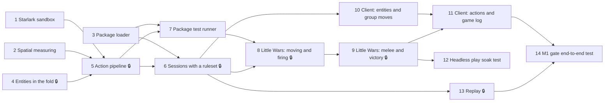

# M1 issue list (proposed)

**Milestone:** M1: Rules engine
**Gate:** Little Wars plays end to end and replays from the log.

These become GitHub issues with the `ready` label and the M1 milestone once Nick approves this list, ADR-004, ADR-005, and the [Little Wars adaptation](little-wars-adaptation.md). Each one is a single branch and PR. 🔒 marks an issue whose PR needs Nick's review before merge: it touches dice, seat permissions, or visibility (ADR-000 item 6), or adds rules content (item 7).

---

## 1. Starlark sandbox

`internal/rules/sandbox` runs package scripts with `go.starlark.net` under ADR-005's limits. It adds the pinned module to `go.mod` and `deps-allowlist.txt`, under the sign-off given on the planning PR.

**Acceptance criteria**
- `load()` works for `.star` files in the same package and fails for anything else, including `..` paths.
- There is no way for a script to read the time, draw randomness, or touch files, the network, or the environment. A test tries each one and checks it's absent.
- A script that loops forever stops at the step limit with a `rule_error` that names the file and line.
- Values handed to scripts are frozen, so mutating them fails.
- The same script with the same input produces byte-identical output 100 times in a row.

**Depends on:** ADR-005 accepted.

## 2. Spatial measuring

`internal/spatial`: circle and rectangle bases with poses, edge-to-edge and centre-to-centre distance, "within radius" queries, and the swept path ADR-005 calls `sweep`. Pure Go, no dependencies.

**Acceptance criteria**
- Table-driven tests for circle–circle, circle–rect, and rect–rect at several rotations, with known answers (touching is 0, overlapping is 0).
- `sweep` returns the bases a path touches in order along the path, and none it misses by more than the tolerance.
- `within` returns entities nearest first, with ties broken by id, so results are deterministic.

**Depends on:** ADR-005 accepted.

## 3. Ruleset package loader

`internal/rules/pkg` reads and validates a package (ADR-004): the manifest, the schema language, data, and that the scripts load. It computes the content hash, embeds `rulesets/` in the binary, and stores used packages in a `ruleset_packages` table by hash. Adds `chartroomd ruleset check <dir>`.

**Acceptance criteria**
- Each kind of invalid package (bad manifest, unknown `format` or `engine_api`, missing license, a bad schema type, data that isn't JSON, a script that doesn't load) is rejected with an error that names the file and the problem.
- The hash is the same on every machine and changes when any file changes (test).
- The server checks every built-in package at startup and refuses to start if one is invalid.
- A package stored by hash loads back byte for byte.

**Depends on:** ADR-004 accepted.

## 4. Entities in the fold 🔒

`internal/table` gains entities, game components, sides, the floor, and ADR-005's event types, with schema validation of components. `StateVersion` bumps. The protocol's `EventData`, the welcome `State`, and the visibility filter's `State` cover the new state, and the TypeScript is regenerated.

**Acceptance criteria**
- Every new event type folds as ADR-005 describes, including `unset`, removal, and parents (tests).
- An event whose components don't match the schema fails the fold with `ErrInconsistent`.
- Snapshot-plus-tail equals fold-from-zero for generated sequences of the new events.
- The filter passes the new events unchanged and still removes the dice seed. The existing hide-everything test still covers every outgoing path.

**Depends on:** ADR-005 accepted. 🔒 visibility filter.

## 5. Action pipeline 🔒

The session loop runs `action.take`: `authorize` checks the floor and the action's phases, args are validated, the script runs with ADR-005's `ctx` (reads, measuring, `ctx.roll` through the dice source, effects), and the effects become one atomic batch of events headed by `action.resolved`, then `after_action` runs.

**Acceptance criteria**
- An action from a side without the floor, or in a phase it isn't allowed in, is rejected before any script runs.
- A script error, a step-limit hit, or an invalid effect rejects the intent with `rule_error`, and nothing is logged, including no dice (test).
- `ctx.roll` uses consecutive roll indexes and logs each roll in order within the batch. A restart mid-game continues the same dice sequence (test, like the existing dice restart test).
- Effects apply to a working copy, so reads later in the same action see them.
- `ctx.end_game` stops all further actions with `game_over`.

**Depends on:** 1, 2, 4. 🔒 dice and seat permissions.

## 6. Sessions with a ruleset 🔒

`POST /api/sessions` takes `ruleset` and `options`. `GET /api/rulesets` lists packages. Creating a session stores the package by hash, logs `session.ruleset_selected`, and runs `setup`. Loading a session uses its pinned copy. Adds `side.join` (one seat per side) and the welcome's `ruleset` catalogue.

**Acceptance criteria**
- A session keeps running its pinned package after the built-in one changes (test with two versions).
- A second seat can't join a side that's taken. A seat with no side can watch but not act.
- The welcome's catalogue lists sides, kinds and bases, game components, and actions with their args schemas and phases, and the TypeScript types are regenerated.
- Sessions without a ruleset still work exactly as in M0.

**Depends on:** 3, 5. 🔒 seat permissions.

## 7. Package test runner

Runs `tests/*.json` scenarios (ADR-004) through the real engine: setup, seed, actions with sides, and expected events, state, or rejections. `make rulesets` runs `chartroomd ruleset check` on every built-in package, and CI runs it.

**Acceptance criteria**
- A failing expectation reports the scenario, the step, and the expected and actual values.
- Tests can expect a rejection with a code and part of its message.
- A test package in the runner's own tests passes, and a broken copy of it fails.

**Depends on:** 3, 5.

## 8. Little Wars: moving and firing 🔒

`rulesets/little_wars`: manifest, schema, Wells's 150-point example army and a small skirmish preset (for tests and the gate), setup, deployment, alternating moves with the `guns` and `men` phases, movement limits, gun crew, moving guns, and firing with the shot model, all as signed off in the adaptation document.

**Acceptance criteria**
- Every rule in the adaptation's movement and firing rows has a package test.
- With a fixed seed, a shot's landing point and casualties are what the test expects, including a friendly casualty.
- The README states the source and license.

**Depends on:** 6, 7. 🔒 rules content.

## 9. Little Wars: melee, prisoners, and victory 🔒

Melee at the end of a move, isolation, the moving side's `melee` choice phase, prisoners, escorts, liberation and rearming, gun capture, surrender, Fight to a Finish, scoring, and the draw rule.

**Acceptance criteria**
- Wells's own example (9 against 11, isolated: 2 prisoners and 7 dead each) is a passing test, as are equal numbers and supported inferior forces.
- Escort, liberation, rearming, gun capture, surrender, scoring, and the draw rule each have a test.
- A full skirmish game plays from setup to `game.ended` in a scenario test.

**Depends on:** 8. 🔒 rules content.

## 10. Client: entities and group moves

The table draws entities from their bases and sides, alongside M0's tokens. You can select one or many (click, shift-click, drag a box) and move them together with ghosts and a distance readout per man. A floor and phase indicator, a side picker on joining, and a ruleset picker in the lobby.

**Acceptance criteria**
- The client reducer folds every new event type (Vitest).
- Dragging a group sends one `action.take` with each man's new pose. Nothing moves until the events arrive, as in M0.
- A seat watching, or not holding the floor, can select but not move.

**Depends on:** 4, 6.

## 11. Client: actions and the game log

Action buttons and forms built from the welcome's catalogue: point arguments by clicking the table (aiming a gun), entity arguments from the selection, and the melee choice with its suggested default. The game log shows `rule.noted` lines, rolls, and action headings together. Live scores and a game-over banner.

**Acceptance criteria**
- Every Little Wars action can be taken from the UI, without any Little Wars-specific client code (the catalogue drives it).
- A rejection shows its message to the person who acted.
- The game log reads in log order and is the same for both players.

**Depends on:** 9, 10.

## 12. Headless play soak test

A Go test plays many seeded Little Wars games with a simple random policy (pick a legal-looking action, accept refusals) until `game.ended` or a move limit. This finds script errors and engine edge cases, and it's the first piece of M5's simulator.

**Acceptance criteria**
- 50 seeded games finish with no `rule_error`.
- For each game, folding its log from zero gives exactly the live state, and so does snapshot-plus-tail.
- It runs in CI in under a minute (fewer games under `-short`).

**Depends on:** 9.

## 13. Replay 🔒

`GET /api/sessions/{id}/events` returns the log as a spectator sees it (through the visibility filter). `/s/<id>/replay` folds it with the client's reducer and steps through it: back, forward, jump to any action, with each action's heading shown.

**Acceptance criteria**
- The events endpoint never returns the dice seed (test, like the existing WebSocket seed test).
- Stepping to the last seq shows exactly the live table (Vitest on the reducer, and in #14 end to end).
- Replay works for M0-style sessions too.

**Depends on:** 4, 6. 🔒 visibility filter.

## 14. M1 gate: end-to-end test

A Playwright test with two browsers against a real `chartroomd`, extending M0's.

**Acceptance criteria**
- Both players create and join a Little Wars skirmish from the lobby and take a side each.
- They play it to a result through the UI: deployment, moves, gun fire, and at least one melee with a casualty choice.
- The server is killed and restarted mid-game; both reconnect and the game continues.
- After `game.ended`, the replay view stepped to the end matches the final table, and stepped to the start matches the deployment.
- Runs in CI.

**Depends on:** 11, 13.
